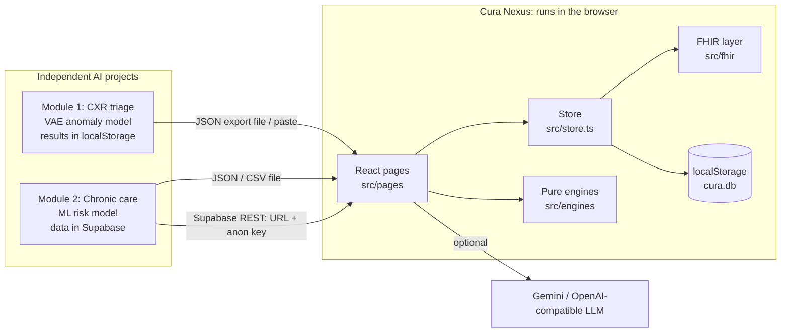
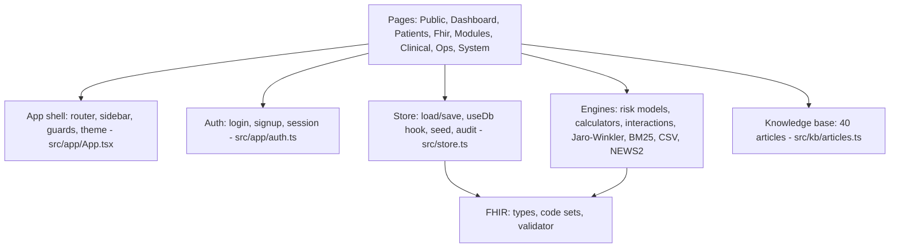
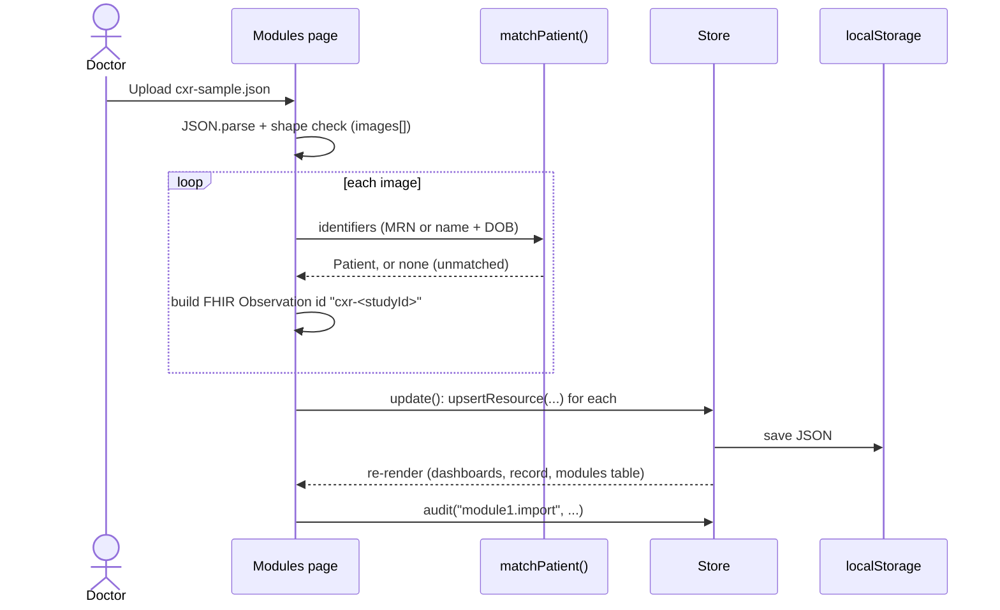

# Cura Nexus

**Unified Patient Record & Interoperability Platform**
*One patient, one record, any source, works offline.*

This README is the complete guide to the project. It starts with what the project is and how to run it, then covers the architecture, the data model and the algorithms. It also explains how the project was built, step by step, and ends with a set of questions you are likely to be asked about it, with answers.

---

## Table of contents

1. [What is Cura Nexus?](#1-what-is-cura-nexus)
2. [The problem statement](#2-the-problem-statement)
3. [Quick start (run it)](#3-quick-start-run-it)
4. [Demo logins](#4-demo-logins)
5. [Guided tour: what to click](#5-guided-tour-what-to-click)
6. [Tech stack, and why each piece](#6-tech-stack-and-why-each-piece)
7. [Architecture](#7-architecture)
8. [Folder structure](#8-folder-structure)
9. [Data model](#9-data-model)
10. [System flows](#10-system-flows)
11. [Algorithms and formulas](#11-algorithms-and-formulas)
12. [Connecting Module 1 and Module 2](#12-connecting-module-1-and-module-2)
13. [How we built it, step by step](#13-how-we-built-it-step-by-step)
14. [Deploying](#14-deploying)
15. [npm scripts](#15-npm-scripts)
16. [Limitations](#16-limitations)
17. [Security notes](#17-security-notes)
18. [Interview and viva Q&A](#18-interview-and-viva-qa)
19. [Glossary](#19-glossary)
20. [Troubleshooting](#20-troubleshooting)

---

## 1. What is Cura Nexus?

Hospitals, especially in India, run many separate systems: one for imaging, one for the lab, one for the chronic-care clinic, one for billing. These systems rarely share a patient's identity. As a result, one person ends up with several partial records spread across them.

Cura Nexus is a web app that **pulls these sources into one patient record**. It stores that record in the international **FHIR R4** format, which is the standard way health data is exchanged.

The app:

- keeps every patient's data (demographics, conditions, medicines, vitals, lab results and consent) as FHIR R4 resources;
- **imports results from two independent AI projects** (a chest X-ray triage model and a chronic-disease risk model), matches each result to the right patient, and shows it on that patient's record with a badge naming its source;
- adds everyday hospital tools: dashboards, registration with a duplicate check, risk checks, calculators, an ICU monitor, a bed board, appointments, billing, discharge summaries, a drug-interaction checker, a chat assistant, an admin page with an audit log, and settings;
- runs **completely in the browser**. There is no server, no database to install, and no API keys are needed. Data lives in the browser's `localStorage`, and synthetic demo data is created on the first visit.

> Everything is synthetic demo data. Cura Nexus is decision support for demonstration only. It is **not a medical device**.

---

## 2. The problem statement

The system has three parts:

| # | Item | Where it lives |
|---|------|----------------|
| 1 | **Batch Chest X-Ray Triage.** A reconstruction-based (autoencoder/VAE-style) anomaly model scores each image, ranks the batch and puts the highest-priority cases first for the radiologist. | **Independent project**, built separately with its own trained model. It stores its results in its own browser's `localStorage`. |
| 2 | **Chronic-Disease Follow-up Risk Prioritisation.** An ML model scores patients from their visits, medicines, missed appointments and past readings, and sorts them into High/Medium/Low with the contributing factors. | **Independent project**, built separately with its own trained model. It stores its data in **Supabase**. |
| 3 | **Centralised Record & Interoperability Layer.** The results of items 1 and 2 are written into one FHIR R4 patient record that both the doctor and patient dashboards can read. | **This project: Cura Nexus.** |

Key design rule: **Cura Nexus never scores X-rays or chronic risk itself.** It receives the outputs of your trained models, matches them to patients, stores them as FHIR resources and displays them. This keeps the AI models as independent services that talk to Cura Nexus through a defined data format (a "contract").

The in-app **Problem Statement** page (`/problem-statement`) shows all three items. Items 1 and 2 have the badge "Independent project, connected via Cura Nexus" and a live count of how many of their results are in the record. Item 3 has the badge "Implemented here" and links to the pages that deliver it.

---

## 3. Quick start (run it)

**You need:** Node.js 18 or newer, which includes npm. Check with `node -v`.

From the project folder (`D:\Cura Nexus`), install the dependencies:

```bash
npm install
```

Start the development server:

```bash
npm run dev
```

Then open **http://localhost:5173**. If port 5173 is busy, Vite picks the next free port and prints it in the terminal.

To build the production version (a static site written to `dist/`):

```bash
npm run build
```

To serve that build locally at http://localhost:4173:

```bash
npm run preview
```

On the first visit the app creates its demo data in your browser. To start over, either sign in as admin or doctor and use **Settings → Reset demo data**, or clear the site's storage in your browser.

---

## 4. Demo logins

All demo accounts use the password **`Demo@123`**. The login page also has a one-click button for each one.

| Role | Email | What they see |
|------|-------|---------------|
| Doctor | `doctor@cura.ai` | Dr Ananya Iyer. Staff dashboard, patients, FHIR viewer, Connected Modules, clinical and operations tools. |
| Nurse | `nurse@cura.ai` | Grace Thomas. Same staff tools as the doctor, without billing. |
| Patient | `patient@cura.ai` | Asha Patil (patient `pt-001`, MRN `CN-000001`). Only her own record, appointments, invoices, chat and tools. |
| Admin | `admin@cura.ai` | Sanjay Gupta. Everything, plus the **Admin** page (users and audit log). |

**Sign up** (`/signup`):
- A **patient** sign-up is active immediately. It also creates a new FHIR `Patient` resource for that person.
- A **doctor** or **nurse** sign-up is created as **pending**. The person can't sign in until an admin approves them under **Admin → Users**.

---

## 5. Guided tour: what to click

### As the doctor (`doctor@cura.ai`)

1. **Dashboard**: the KPIs (patients, appointments booked, beds occupied, unpaid invoices), the CXR worklist, high-risk chronic follow-ups, and recent activity from the audit log.
2. **Connected Modules**: click **Import sample file** under both Module 1 and Module 2. You'll see "Imported N result(s)", plus one or more results the app couldn't match to a patient (one sample uses an MRN that doesn't exist on purpose). Go back to the Dashboard and both worklists are now filled.
3. **Patients**: search the list. Open **Asha Patil**. Her **Timeline** shows a badge on each entry naming its source ("Cura Nexus", "Module 1 — CXR triage", "Module 2 — Chronic care"). The **Vitals** tab has a chart of SBP, DBP and HR. On the **Consent** tab, try revoking her consent: her clinical data is then hidden from staff. Grant it again to restore it. Click **Export FHIR Bundle** to download her whole record as JSON.
4. **Patients → Add patient**: type a name, date of birth and phone that match an existing patient. The **duplicate check** lists likely matches with a percentage. Either open the existing patient, or click "Create new patient anyway".
5. **FHIR Viewer**: browse resources by type and patient. Each resource shows a validation badge and a quality score. You can copy or download the JSON, and import a Bundle. Try `public/samples/sample-bundle.json` using the "Download sample Bundle" button.
6. **Risk checks / Calculators / Drug interactions / Discharge summary**: each is self-contained and recalculates as you type.
7. **ICU monitor**: the vitals update every 2 seconds. One patient slowly gets worse until a NEWS2 alert appears (the card turns red).
8. **Bed board**: admit a patient to a free bed, discharge them (the bed moves to cleaning), then mark it clean.

### As the patient (`patient@cura.ai`)

You only see your own data: conditions, medicines, latest results, your appointments (you can book and cancel), your invoices, the chat in simpler language, and your full record with consent controls.

### As the admin (`admin@cura.ai`)

Open **Admin**: approve pending staff, change roles, and filter or export the **audit log** as CSV. Every sign-in, registration, import, consent change, invoice and bed movement is recorded there.

---

## 6. Tech stack, and why each piece

| Layer | Technology | Why |
|-------|-----------|-----|
| Language | **TypeScript** (strict mode) | Types catch mistakes at build time. FHIR resources are typed in `src/fhir/types.ts`. |
| UI library | **React 18** | Component model, large ecosystem. |
| Build tool / dev server | **Vite 5** | Fast dev server with hot reload. `vite build` outputs a static site. |
| Styling | **Tailwind CSS 3** + CSS variables | Utility classes; light/dark themes by switching CSS variables (`src/index.css`). |
| Routing | **React Router 6** | Client-side pages (`/app/patients/:id`, …) and route guards. |
| Charts | **Recharts** | Vitals trend lines, risk-factor bar charts, ICU sparklines. |
| Icons | **lucide-react** | Clean, consistent icon set. |
| Fonts | **@fontsource** Inter + Manrope | Bundled, so they also work offline. |
| Storage | Browser **localStorage** | No setup at all; data survives page reloads. |
| Hashing | **Web Crypto API** (SHA-256) | Built into every browser; passwords are never stored in plain text. |
| Health data standard | **HL7 FHIR R4** | The international standard for exchanging health records; used by India's ABDM. |
| Terminologies | **LOINC, SNOMED CT, ICD-10, RxNorm** | Standard codes for tests, conditions, diagnoses and medicines (`src/fhir/codes.ts`). |
| Package manager | **npm** | Works the same on Windows, macOS and Linux. |
| Hosting | Any static host (**Vercel**, Netlify, GitHub Pages) | No server is required. |

Installed but not used by the current pages (left over from the larger first plan, see §13): Dexie, Zod, Zustand, react-hook-form, framer-motion, supabase-js, Vitest and Playwright.

---

## 7. Architecture

### 7.1 Big picture



### 7.2 Layers inside the app



- **Pages** are React components. They read data with `useDb()` and change it with `update()`.
- **The store** (`src/store.ts`) is the single source of truth. It holds one JSON object in `localStorage` under the key `cura.db`, notifies React on every change (`useSyncExternalStore`), and seeds the demo data.
- **Engines** (`src/engines/`) are pure TypeScript functions with no React and no storage. Examples are `egfrCkdEpi2021()`, `scoreRisk()` and `checkInteractions()`. That makes them easy to test and reuse.
- **The FHIR layer** (`src/fhir/`) has the TypeScript types for FHIR resources, the embedded code sets, and the structural validator.

### 7.3 Request flow (example: importing a CXR result)



---

## 8. Folder structure

```
Cura Nexus/
├── index.html               # HTML shell; applies the saved theme before React loads
├── package.json             # dependencies and npm scripts
├── vite.config.ts           # Vite config (port 5173, "@" → src, base path)
├── tailwind.config.ts       # theme tokens mapped to CSS variables
├── vercel.json              # SPA rewrite so deep links work on Vercel
├── netlify.toml / public/_redirects   # same, for Netlify
├── public/
│   ├── samples/             # sample files to import (see §12)
│   │   ├── cxr-sample.json        # Module 1 sample results
│   │   ├── chronic-sample.json    # Module 2 sample results (JSON)
│   │   ├── chronic-sample.csv     # Module 2 sample results (CSV)
│   │   └── sample-bundle.json     # a FHIR Bundle to import
│   ├── manifest.webmanifest, sw.js, icons/   # PWA files (service worker not registered yet)
├── src/
│   ├── main.tsx             # entry: loads fonts + CSS, seeds the DB, renders <App/>
│   ├── index.css            # Tailwind + light/dark CSS variables + .card/.btn/.input/.table classes
│   ├── store.ts             # localStorage database, types, FHIR helpers, seed
│   ├── seed-names.ts        # Indian names / cities used by the seed
│   ├── app/
│   │   ├── App.tsx          # routes, sidebar (NAV), role guards, theme toggle, logo
│   │   └── auth.ts          # login, signup, logout, useSession()
│   ├── pages/
│   │   ├── Public.tsx       # Landing, Login, Signup, ProblemStatement
│   │   ├── Dashboard.tsx    # doctor/staff + patient dashboards, shared helpers
│   │   ├── Patients.tsx     # list, add/edit (+ duplicate check), unified record
│   │   ├── Fhir.tsx         # FHIR viewer + Bundle import
│   │   ├── Modules.tsx      # Module 1/2 import, Supabase sync, patient matching
│   │   ├── Clinical.tsx     # risk checks, calculators, interactions, discharge
│   │   ├── Ops.tsx          # ICU monitor, beds, appointments, billing
│   │   └── System.tsx       # chat, admin, settings
│   ├── engines/             # pure algorithms (see §11)
│   ├── fhir/                # types.ts, codes.ts, validator.ts (+ search, mappers, contracts)
│   ├── kb/articles.ts       # 40 short medical knowledge articles for the chat
│   └── lib/                 # small helpers: random generator, hashing, formatting, downloads
├── SPEC.md                  # the original full specification (word for word)
├── PROGRESS.md              # what is simplified compared with SPEC.md
├── FEATURE_INVENTORY.md     # reference-project feature map (planning document)
└── _archive/                # unused first-phase code (IndexedDB service layer); not built
```

The `@/` prefix in imports means `src/`. For example, `@/store` is `src/store.ts`.

---

## 9. Data model

### 9.1 What is stored in `localStorage`

| Key | Contents |
|-----|----------|
| `cura.db` | The whole database as one JSON object (shape below). |
| `cura.session` | `{ email, at }` for the signed-in user. Deleted on sign-out. |
| `cura.theme` | `"light"` or `"dark"`. |

The shape of `cura.db` (defined in `src/store.ts`):

```ts
interface Db {
  version: number;             // schema version; if it changes, the app re-seeds
  users: User[];               // { id, email, name, role, salt, hash, patientId?, status }
  resources: FhirResource[];   // ALL clinical data, as FHIR R4 resources
  audit: AuditRow[];           // { id, at, user, action, detail }, newest first, max 1000
  appointments: Appointment[]; // { id, patientId, doctor, start, reason, status }
  invoices: Invoice[];         // { id, patientId, date, items[{name, amount}], status }
  beds: Bed[];                 // { id, ward, label, patientId?, status: free|occupied|cleaning }
  settings: Settings;          // ai: { provider, key, baseUrl, model }, db: { mode, url, key }
}
```

Clinical data is stored as FHIR resources. Operational data (users, beds, invoices, appointments) is stored as plain rows, which keeps those features simple.

### 9.2 FHIR resources used

| Resource | What it holds | Created by |
|----------|---------------|-----------|
| `Patient` | name, gender, birthDate, phone, city, identifiers (MRN, optional ABHA) | seed, Add patient, patient sign-up, Bundle import |
| `Observation` | vitals and labs (SBP, DBP, HR, HbA1c…), and **CXR anomaly scores from Module 1** | seed, Module 1 import, Bundle import |
| `Condition` | diagnoses (SNOMED CT + ICD-10 codes) | seed, Bundle import |
| `MedicationRequest` | prescriptions (RxNorm codes) | seed, Bundle import |
| `Consent` | the patient's permission for the care team to see their data (active/inactive) | seed, registration, grant/revoke |
| `RiskAssessment` | **chronic-care risk from Module 2**: probability, tier, factors, recommended action | Module 2 import |
| `DocumentReference` | saved discharge summaries (base64 text) | Discharge summary page |

Every stored resource has a `meta` field:
- `meta.source`: where the resource came from, for example `"Cura Nexus"`, `"Module 1 — CXR triage"`, `"Module 2 — Chronic care"` or `"FHIR Bundle import"`. **This is what the source badges on the timeline show.**
- `meta.versionId`: goes up by 1 every time the resource is updated (see `upsertResource()` in `src/store.ts`).
- `meta.lastUpdated`: the time of the last write.

References point at the patient in the standard FHIR way: `subject: { reference: "Patient/pt-001" }`.

### 9.3 Identifiers and codes

| Item | Format / system |
|------|-----------------|
| Patient id | `pt-001` … `pt-030` (seed); `pt-xxxxxxx` (new) |
| MRN | `CN-000001` …, system `https://cura-nexus.local/fhir/sid/mrn` |
| ABHA number | 14 digits, system `https://healthid.ndhm.gov.in` (about 60% of seeded patients have one) |
| Lab and vital codes | LOINC, e.g. `8480-6` systolic BP, `8462-4` diastolic BP, `8867-4` heart rate, `4548-4` HbA1c |
| Conditions | SNOMED CT + ICD-10, e.g. type 2 diabetes `44054006` / `E11.9`, hypertension `38341003` / `I10` |
| Medicines | RxNorm, e.g. metformin `6809`, amlodipine `17767`, warfarin `11289` |

All of these come from the small embedded code set in `src/fhir/codes.ts`.

### 9.4 Demo data (the seed)

`initDb()` in `src/store.ts` runs on the first load, or when you choose **Reset demo data**. It uses a **seeded random generator** (mulberry32, seed `20241017`), so the same patients appear every time. It creates:

- **30 synthetic Indian patients**. `pt-001` is always **Asha Patil**, with type 2 diabetes and hypertension.
- For each patient: 1–3 chronic conditions, 1–3 medicines, and **6 visits about 60 days apart**. Each visit records SBP, DBP and HR; every other visit also records HbA1c (higher if the patient is diabetic). Each patient also gets an active treatment Consent.
- **4 users**: doctor, nurse, admin, and patient (linked to `pt-001`). Passwords are hashed.
- **24 beds** in 3 wards (ICU, General Medicine, Surgical; 8 each). In each ward, 5 beds are occupied, 1 is being cleaned and 2 are free.
- **8 appointments** and **6 invoices**.

If the stored `version` doesn't match the code's `VERSION`, the app re-seeds automatically.

---

## 10. System flows

### 10.1 App start

`main.tsx` calls `initDb()`. If `cura.db` exists and its version matches, the app uses it; otherwise it generates the seed and saves it. React then renders `<App/>`, and the router shows the page for the current URL.

### 10.2 Sign in, sign up, sign out (`src/app/auth.ts`)

- **Login**: find the user by email, then compute `SHA-256(salt + ":" + password)` and compare it with the stored hash. If the account is pending, the user is told to wait for approval. On success, `{email}` is written to `cura.session`, a `login` audit row is added, and the user goes to `/app`.
- **Signup**: rejects an email that is already registered and passwords shorter than 8 characters. It creates a random salt and the hash. A patient sign-up also creates a FHIR `Patient` and is active immediately; staff sign-ups are `pending`.
- **Logout**: adds an audit row and removes `cura.session`.
- **Guards**: `Shell` sends anyone who isn't signed in to `/login`. `Guard` checks the user's role against the page's allowed roles. The sidebar (`NAV` in `App.tsx`) only lists the pages your role can open.

### 10.3 Registering a patient, with the duplicate check (`Patients.tsx`)

1. The form validates the input: names are required, the DOB must be a valid date and not in the future, a phone needs at least 10 digits, and an ABHA number must have 14 digits.
2. **Duplicate check**: every existing patient gets a score (formula in §11.2). Any patient scoring **75% or more** is shown as a likely duplicate.
3. You then either click **"This is the same patient"** to open the existing record, or **"Create new patient anyway"**.
4. Saving creates a FHIR `Patient` with a new MRN `CN-0000NN` and an active `Consent`, and adds an audit row. Editing increments the patient's `versionId`.

### 10.4 Opening the unified record, and consent

- The record collects every resource that refers to the patient (`forPatient()` matches `subject` or `patient` = `Patient/<id>`).
- **Consent rule**: if the viewer is staff and the patient has **no active Consent**, the clinical data is hidden. A button lets staff record consent on the patient's behalf.
- The tabs are **Timeline** (every resource sorted by date, with its source badge), **Vitals** (chart), **Consent** (grant or revoke) and **Audit** (audit rows that mention the patient).
- **Export FHIR Bundle** downloads `{resourceType: "Bundle", type: "collection", entry: [Patient, ...all their resources]}`.

### 10.5 Importing module results

See §12 for the formats. Each result is matched to a patient in two steps:
1. an **exact MRN** match;
2. otherwise, **the same date of birth AND a Jaro–Winkler name similarity of 0.9 or more**.

Results that don't match any patient are **not stored**. They're listed back to you as unmatched. The rest are stored with deterministic ids, so **importing the same file again updates the existing resources instead of duplicating them**:
- CXR: `Observation/cxr-<studyId>`
- Chronic: `RiskAssessment/chr-<patientId>` (one per patient; the latest import replaces the previous one)

### 10.6 FHIR Bundle import (`Fhir.tsx`)

Upload or paste JSON. The app accepts a Bundle or a single resource. **Every resource is validated first.** If any of them fails, nothing is imported and the first error is shown. If they all pass, each resource is upserted with the source `"FHIR Bundle import"`.

### 10.7 Chat (`System.tsx`)

1. **Without an AI provider**: the question goes through **BM25 search** over the 40 built-in knowledge articles. The best 1–2 articles that score above 2 become the answer, each with its source guideline. Patient accounts get the simpler wording.
2. **With an AI provider** (Settings): the question is sent to Gemini or to an OpenAI-compatible `/chat/completions` endpoint. If that call fails, the knowledge-base answer is shown along with the error.

### 10.8 ICU monitor (`Ops.tsx`)

Every 2 seconds, each occupied ICU bed gets new vitals: a small random step from the previous values. The second ICU patient is set to slowly get worse (heart rate and breathing rate rise; oxygen and BP fall). **NEWS2** is recalculated on every update; at **5 or more** the card turns red and shows the recommended response. These vitals are simulated, not real device data.

---

## 11. Algorithms and formulas

All of these are pure functions in `src/engines/`.

### 11.1 Jaro–Winkler string similarity (`jaroWinkler.ts`)

This measures how similar two names are, from 0 to 1. It tolerates typos and transposed letters: "Venkataraman" vs "Venkatraman" scores about 0.97.

- **Jaro:** `jaro = (m/|a| + m/|b| + (m − t)/m) / 3`
  - `m` = the number of characters that match within a window of `⌊max(|a|,|b|)/2⌋ − 1` positions
  - `t` = half the number of matched characters that appear in a different order
- **Winkler bonus** for a shared start (prefix): `jw = jaro + ℓ · 0.1 · (1 − jaro)`, where `ℓ` is the length of the common prefix (at most 4).

### 11.2 Duplicate-patient score (`Patients.tsx`)

```
score = 0.5 × JaroWinkler(full name)
      + 0.3 × DOB   (1 if exactly equal, 0.5 if same year, else 0)
      + 0.2 × phone (1 if the last 10 digits are equal, else 0)
flag as likely duplicate when score ≥ 0.75
```

The weights reflect how reliable each signal is. Names have typos, so the name alone isn't enough. Matching name and DOB already scores about 0.8.

### 11.3 Disease risk checks (`risk/models.ts`)

There are five **logistic regression** models: diabetes, heart, liver, kidney and lungs. Each feature is measured against the value for a typical healthy person (its "reference" value):

```
logit(p) = β₀ + Σ βᵢ · (g(xᵢ) − g(refᵢ))        g = identity or ln
p = 1 / (1 + e^(−logit))
```

- `β₀` is the log-odds for a reference person, so `e.g. 8%` baseline for diabetes.
- Each term `βᵢ · (g(xᵢ) − g(refᵢ))` is **that feature's contribution**, which is what the bar chart shows. Red bars push the risk up and green bars push it down.
- The tiers are: diabetes medium ≥ 20%, high ≥ 45%; heart 10% / 20%; liver 12% / 30%; kidney 10% / 25%; lungs 12% / 30%.
- The coefficients are **illustrative**. They were inspired by published scores (IDRS/FINDRISC, Framingham, FIB-4 inputs, KFRE inputs, COPD questionnaires, biomass exposure) but are **not fitted to real data**.

### 11.4 Clinical calculators (`calculators.ts`)

| Calculator | Formula | Source |
|-----------|---------|--------|
| **eGFR (CKD-EPI 2021, race-free)** | `142 × min(Scr/κ,1)^α × max(Scr/κ,1)^−1.200 × 0.9938^age × 1.012 [female]`, where κ = 0.7 (F) / 0.9 (M) and α = −0.241 (F) / −0.302 (M) | Inker et al., NEJM 2021 |
| CKD stage | G1 ≥ 90, G2 60–89, G3a 45–59, G3b 30–44, G4 15–29, G5 < 15 | KDIGO |
| **BMI** | `weight(kg) / height(m)²`, with WHO **Asian** cut-offs (≥ 23 overweight, ≥ 25 obese) | WHO, Lancet 2004 |
| **FIB-4** | `(age × AST) / (platelets × √ALT)`: < 1.3 low (< 2.0 if age ≥ 65), > 2.67 high | Sterling et al., Hepatology 2006 |
| **NEWS2** (ICU page) | points for breathing rate, SpO₂, oxygen use, SBP, pulse, consciousness and temperature; total 5–6 = medium, ≥ 7 = high, any single 3 = urgent review | Royal College of Physicians, 2017 |

Checked against known values: eGFR for a 50-year-old man with creatinine 1.0 is about 92.

The engine file also contains Framingham, CHA₂DS₂-VASc and qSOFA, which have no page yet. The Framingham code reproduces the published worked examples (10.48% and 15.6%).

### 11.5 Drug-interaction checker (`pharmacy.ts`)

This uses an embedded rule table of about 25 rules. A rule can name a drug or a **drug class**, for example "any NSAID + warfarin → major bleeding risk". Every pair among the selected medicines is checked against each rule, in both directions. The results are sorted by severity (contraindicated → major → moderate → minor) and show the effect and how to manage it. Try warfarin + ibuprofen, simvastatin + clarithromycin, or sildenafil + nitroglycerin.

### 11.6 BM25 search for the chat (`bm25.ts`)

Okapi BM25 is the classic ranking formula behind keyword search engines:

```
score(D,Q) = Σ IDF(q) · f(q,D)(k₁+1) / ( f(q,D) + k₁(1 − b + b·|D|/avgdl) )
IDF(q)     = ln(1 + (N − n(q) + 0.5)/(n(q) + 0.5))      k₁ = 1.5, b = 0.75
```

Before scoring, the text is lower-cased, common stop-words are removed, words are trimmed to their stem, and some synonyms are expanded ("sugar" → "glucose"). Words in an article's title count double.

### 11.7 Simulated ICU vitals

Each vital takes a bounded random step every 2 seconds. A built-in drift makes one patient deteriorate. NEWS2 (§11.4) turns those numbers into an alert level.

### 11.8 FHIR validator (`fhir/validator.ts`)

The validator checks each resource's structure:
- required fields are present (an Observation needs a `status`, a `code` and a `subject`);
- values come from the allowed lists (e.g. `gender`);
- dates are valid and not in the future;
- references are well formed (`Type/id`);
- code systems are recognised;
- values are physically plausible (a heart rate of 400 is flagged).

Its output is `{ valid, issues[], score }`. The score is `100 − 50 × errors − 10 × warnings`. The FHIR Viewer shows this result, and Bundle import uses it to reject bad data.

---

## 12. Connecting Module 1 and Module 2

Everything happens on the **Connected Modules** page (`/app/modules`).

### 12.1 Module 1: CXR triage (stores its results in `localStorage`)

A browser's `localStorage` can only be read by pages from the same origin (protocol + domain + port). Cura Nexus therefore **can't read Module 1's storage directly**. Instead, Module 1 exports a JSON file, and you import it here by uploading the file or pasting the JSON.

Format (see `public/samples/cxr-sample.json`):

```json
{
  "batchId": "CXR-BATCH-SAMPLE-A",
  "model": { "name": "cxr-vae-anomaly", "version": "2.3.1" },
  "images": [
    { "patient": { "mrn": "CN-000003" }, "studyId": "CXR-10431",
      "anomalyScore": 0.94, "rank": 1, "priority": "Critical", "findings": "…" },
    { "patient": { "name": "Harish Gowda", "birthDate": "1949-02-17" }, "studyId": "CXR-10436",
      "anomalyScore": 0.58, "rank": 6, "priority": "Review" }
  ]
}
```

- Each image needs a `studyId` and a numeric `anomalyScore`. To identify the patient, give either an `mrn`, or a `name` with a `birthDate`.
- Each image is stored as a FHIR `Observation` (code `cxr-anomaly-score`). The score is in `valueQuantity`, the priority in `valueString`, and the batch, rank and model are in `note`. The source is `"Module 1 — CXR triage"`.
- The results appear on the **doctor dashboard** (worklist sorted by score), on the **Modules page** and on the **patient's timeline**.

**To export from Module 1:** in Module 1's browser console, read its results from `localStorage` and turn them into the format above. For example:

```js
const raw = JSON.parse(localStorage.getItem('YOUR_RESULTS_KEY'));
// build { batchId, model, images: [...] } from raw, then:
const blob = new Blob([JSON.stringify(payload, null, 2)], { type: 'application/json' });
const a = document.createElement('a'); a.href = URL.createObjectURL(blob); a.download = 'cxr-for-cura.json'; a.click();
```

### 12.2 Module 2: Chronic care (stores its data in Supabase)

There are three ways in:

1. **JSON** (see `public/samples/chronic-sample.json`):
   ```json
   { "model": { "name": "chronic-followup-xgb", "version": "1.4.0" },
     "patients": [
       { "patient": { "mrn": "CN-000001" }, "riskScore": 0.82, "tier": "High",
         "factors": [{ "name": "Missed appointments", "weight": 0.21 }],
         "recommendedAction": "Phone call within 48 h" } ] }
   ```
   A plain JSON array of table rows is also accepted.
2. **CSV** (see `public/samples/chronic-sample.csv`), with the columns `mrn, risk_score, tier, factors, action`. Factors are written as `name:weight;name:weight`. Instead of `mrn` you can use `name` + `dob`.
3. **Directly from Supabase**: enter Module 2's **Supabase URL**, its **anon key** and the **table name**, then click **Sync from Supabase**. The app calls Supabase's REST API (`GET <url>/rest/v1/<table>?select=*`) and expects the same column names as the CSV (`risk_score` can also be called `score`; `tier` can also be called `risk_level`).
   - If the call fails with 401 or 403, either the anon key is wrong or the table's row-level security (RLS) doesn't allow reading. In Supabase, add a policy along the lines of `create policy "read" on <table> for select to anon using (true);`.
   - Supabase allows requests from the browser (CORS), so no server is needed.

Each patient becomes a FHIR `RiskAssessment`: the probability goes in `prediction[0].probabilityDecimal`, the tier in `qualitativeRisk.text`, the factors in `rationale`, and the recommended action in `mitigation`. The source is `"Module 2 — Chronic care"`. Scores above 1 (e.g. 82) are treated as percentages and divided by 100.

The results appear on the **doctor dashboard** ("High-risk chronic follow-ups"), on the **Modules page** (with the factors) and on the **patient's timeline**.

### 12.3 Sample files

| File | Use |
|------|-----|
| `public/samples/cxr-sample.json` | 6 CXR results. One (Harish Gowda, MRN `EXT-55120`) is deliberately an **unknown patient**, so you can see the unmatched report. |
| `public/samples/chronic-sample.json` | 5 chronic results. MRN `CN-009999` is deliberately **unknown**. |
| `public/samples/chronic-sample.csv` | 3 chronic results in CSV form. |
| `public/samples/sample-bundle.json` | A FHIR Bundle (new patient Kiran Raman + HbA1c + diabetes) for the FHIR Viewer import. |

These are **sample data**: fixed illustrative numbers, not output from the real models.

---

## 13. How we built it, step by step

The project was built in two phases.

### Phase 1: the full plan (foundation work, now partly archived)

1. **Studied the reference project** (`AI-Healthcare-System-main.zip`, unzipped to `_reference/`). This included its README, its 24 pages and its components. Every feature was mapped in `FEATURE_INVENTORY.md`, and infrastructure that can't run in a browser (Rust gateways, Databricks, Kubernetes…) was marked as such.
2. **Set up the project**: Vite + React + TypeScript (strict) + Tailwind, npm scripts, deploy configs (`vercel.json`, `_redirects`) and a PWA manifest.
3. **Wrote the FHIR R4 layer** (`src/fhir/`): TypeScript types for 20 resource types; code sets for LOINC, SNOMED CT, ICD-10 and RxNorm; a structural **validator**; a FHIR **search** implementation; builders; and mappers (HL7 → FHIR, module results → FHIR).
4. **Wrote the pure engines** (`src/engines/`): Jaro–Winkler, Fellegi–Sunter MPI, HL7 v2 parser, CSV parser, consent evaluation, clinical calculators, the five risk models with conformal intervals, an RK4 digital twin, pharmacy rules (interactions, allergies, CPIC pharmacogenomics), BM25, PII redaction, FedAvg federated learning, a Bronze→Silver→Gold data pipeline, OMOP mapping, claims audit, a vitals simulator and narrative generators. The calculators were checked against published values (Framingham 10.48% / 15.6%, eGFR ≈ 92).
5. **Wrote the knowledge base**: 40 short medical articles, each citing a guideline.
6. **Started the full service layer**: an IndexedDB/Dexie database, a REST-like API, an 88-patient seed, and connectors for the postMessage bridge and Supabase mapping. This was cut short by the change of scope below and moved to `_archive/`.

### Phase 2: the 30-minute breadth-first build (what you run today)

The brief changed to "every feature must exist and work, small and simple, localStorage, 30 minutes". So:

1. **Saved the original spec** word for word in `SPEC.md`.
2. **Archived** the IndexedDB service layer and kept the pure engines and the FHIR layer, which were reused.
3. **Wrote `src/store.ts`**: one JSON database in `localStorage`, a `useDb()` React hook, `update()`, `upsertResource()` with version numbers, an `audit()` helper, and the 30-patient seed.
4. **Auth and app shell** (`auth.ts`, `App.tsx`): login, signup and logout, demo accounts, a role-based sidebar, route guards and a dark/light toggle.
5. **Pages**, in priority order: dashboards → patients (with the duplicate check) → unified record (timeline, vitals chart, consent, export) → FHIR viewer (import/export) → Problem Statement → Connected Modules (JSON/CSV/Supabase) → clinical tools → operations → chat, admin and settings.
6. **Sample files** in `public/samples/`.
7. **Verified it**: a type check and `npm run build` passed with zero errors. Every route was then opened in a browser while signed in as the doctor, with no console errors, and both sample imports were run, with the unknown patients correctly reported.
8. **Documented it**: this README, plus `PROGRESS.md` (what is simplified compared with the spec).

---

## 14. Deploying

The app is a static site, so any static host works.

### Vercel

1. Push the folder to GitHub.
2. At vercel.com, choose **New Project** and import the repository. Vercel detects Vite: the build command is `npm run build` and the output directory is `dist`.
3. Deploy. `vercel.json` already sends every route to `index.html`, so links like `/app/patients/pt-001` work when opened directly.

Or from the command line:

```bash
npx vercel --prod
```

### Netlify

`netlify.toml` and `public/_redirects` are already set up. Import the repository and deploy.

### GitHub Pages (served from a sub-path)

```bash
npm run build:gh-pages
```

This builds with the base path `/cura-nexus/`. Publish the `dist/` folder.

> Because data lives in `localStorage`, every visitor's browser gets its own separate copy of the demo data.

---

## 15. npm scripts

| Command | What it does |
|---------|--------------|
| `npm install` | Installs the dependencies (`package-lock.json` pins their versions). |
| `npm run dev` | Starts the development server with hot reload at http://localhost:5173. |
| `npm run build` | Type-checks (`tsc -b`), then builds the static site into `dist/`. |
| `npm run preview` | Serves `dist/` at http://localhost:4173. |
| `npm run typecheck` | Type-checks only. |
| `npm run lint` | Runs ESLint. |
| `npm run build:gh-pages` | Builds for GitHub Pages (`/cura-nexus/` base path). |
| `npm test`, `npm run test:e2e` | Configured, but **no test files exist yet**, so these report that no tests were found. |

`npm install` reports some audit warnings. These come from development dependencies and don't affect the built app.

---

## 16. Limitations

These are all listed in `PROGRESS.md`. The main ones are:

- **Storage is local only.** The "Supabase" and "PostgreSQL REST" database modes in Settings only **test the connection**; the data itself stays in `localStorage`. A browser can't open a raw PostgreSQL connection, so any Postgres option has to go through a REST layer such as PostgREST.
- **Passwords** are hashed with salted SHA-256, not a slow key-derivation function like PBKDF2 or bcrypt. There is no password reset and no session timeout.
- **Patient matching** uses a simple weighted score. The full Fellegi–Sunter MPI engine exists in `src/engines/mpi.ts` but isn't connected to the UI. There's no merge workbench, and unmatched module results are reported rather than queued for review.
- **Consent** is a single active/inactive treatment consent per patient, not scoped per purpose or data type. There is no ABHA OTP linking.
- **Module 1** is imported by file or paste only (no live postMessage bridge). **Module 2's Supabase sync** reads one table with fixed column names, does a full read each time (not incremental), and doesn't write outreach outcomes back.
- **HL7 v2 import** has a working parser (`src/engines/hl7.ts`) but no page yet. CSV is only used for Module 2.
- The **risk models** use illustrative coefficients and don't show confidence intervals in the UI.
- There are **no automated tests yet**. The app was verified by building it and checking it by hand in the browser.
- The data is **synthetic**: 30 patients and about one year of readings. It is not a medical device.

---

## 17. Security notes

- Passwords are never stored. Only `salt` + `SHA-256(salt:password)` are kept.
- Route guards and the role-based menu control what each role can open. Patients can only open their own record.
- Staff can't see a patient's clinical data while that patient has no active consent.
- Every important action is written to the **audit log**, which admins can filter and export.
- AI keys and database keys are stored **only in this browser's `localStorage`**. The Settings page warns about this.
- **Honest caveat:** because everything runs in the browser, anyone with access to that browser profile can read `localStorage` with the developer tools. A real deployment would move the data and the access checks to a server.

---

## 18. Interview and viva Q&A

**Q: What does Cura Nexus do, in one sentence?**
It joins patient data from different sources, including two independent AI models, into one FHIR R4 record, with consent and an audit trail, and it runs entirely in the browser.

**Q: Which part of the problem statement did you implement?**
Item 3, the centralised record and interoperability layer. Items 1 (CXR triage) and 2 (chronic risk) are my separate projects with their own trained models. Cura Nexus imports and displays their results; it doesn't re-score them.

**Q: Why FHIR R4?**
It is the international standard for exchanging health data, it is used by India's ABDM, and it defines a standard structure (Patient, Observation, Condition…) with standard codes (LOINC, SNOMED CT). Any FHIR-capable system could read the exported Bundle.

**Q: What is a FHIR Bundle?**
A container of resources. Cura Nexus exports a `collection` Bundle with the Patient and every resource that refers to them, and it can import Bundles back.

**Q: How does a CXR or chronic result get to the right patient?**
First by an exact MRN match. If that fails, by the same date of birth plus a Jaro–Winkler name similarity of 0.9 or more. Anything that still doesn't match is reported back, not stored, so results are never attached to the wrong person.

**Q: What if I import the same file twice?**
Nothing is duplicated. Ids are derived from the source (`cxr-<studyId>`, `chr-<patientId>`), so a re-import updates the existing resource and increments its `versionId`.

**Q: How do you tell where a piece of data came from?**
Every resource has `meta.source`, for example "Module 1 — CXR triage". The timeline shows it as a coloured badge.

**Q: How does the duplicate check work when registering a patient?**
`0.5 × name similarity + 0.3 × DOB match + 0.2 × phone match`. At 0.75 or more the user sees the likely duplicates and decides whether it's the same person or a new one.

**Q: What is Jaro–Winkler and why use it for names?**
A string-similarity measure between 0 and 1 that copes with typos and transposed letters and gives extra weight to a shared start. That suits Indian names, which are often spelled several ways ("Venkataraman" / "Venkatraman").

**Q: Why localStorage instead of a database server?**
There's nothing to set up: no server, no keys, and it works offline. That fits a demo, and the requirement that the app deploy as a static site. The trade-offs are that storage is limited to about 5 MB, data is per browser, and there's no shared multi-user data. A real deployment would put a FHIR server (such as HAPI FHIR) or Supabase behind the same data shapes.

**Q: How would this scale to a real hospital?**
Swap the store for a real FHIR server (HAPI FHIR, or Postgres with a FHIR API), move authentication and consent checks to the server, add a proper master patient index (the Fellegi–Sunter engine in `src/engines/mpi.ts`), and receive module results through an API instead of files.

**Q: How do the risk checks explain themselves?**
They are logistic models. Each feature's contribution is `β × (value − reference value)` in log-odds, and the bar chart shows these contributions. Red bars push the risk up, green bars push it down.

**Q: Are the risk models accurate?**
They are transparent demonstrations with illustrative, literature-inspired coefficients. They haven't been validated and aren't for diagnosis. The UI says so.

**Q: Which eGFR formula do you use, and why?**
CKD-EPI 2021, which doesn't use race (the older equation did). For example, it gives about 92 for a 50-year-old man with creatinine 1.0.

**Q: What is NEWS2?**
The National Early Warning Score 2. It adds points for abnormal vital signs (breathing rate, SpO₂, oxygen use, BP, pulse, consciousness, temperature). A total of 5 or more triggers an urgent review; the ICU monitor uses that threshold for its alerts.

**Q: How does the chat work without an AI key?**
BM25 keyword search over 40 built-in medical articles. It returns the best one or two articles with their source, and patients get simpler wording. If an AI provider is configured, it's used instead, and the app falls back to the knowledge base if the call fails.

**Q: Why is the LLM optional?**
So the app works offline and for free. The LLM only phrases answers; it never calculates clinical scores.

**Q: How is consent enforced?**
Each patient has FHIR `Consent` resources. If none is active, staff see a "no active consent" message instead of clinical data. Patients can grant or revoke consent, and every change is audited.

**Q: How are passwords stored?**
As a random per-user salt plus `SHA-256(salt:password)`, computed with the browser's Web Crypto API. A production system would use a slow algorithm such as PBKDF2, bcrypt or Argon2, on a server.

**Q: How does reading Module 2's Supabase work from a browser?**
Supabase exposes every table through a REST API (PostgREST). We call `GET <url>/rest/v1/<table>?select=*` with the anon key in the headers. Supabase allows browser requests (CORS), and row-level security decides what the anon key can read.

**Q: Why can't Cura Nexus read Module 1's localStorage directly?**
Browsers restrict `localStorage` to a single origin (protocol + domain + port). An app on another port or domain can't read it, so Module 1 exports a file instead.

**Q: How does dark mode work?**
The colours are CSS variables. Adding the `dark` class to `<html>` switches the whole set, and the choice is saved in `localStorage`.

**Q: How is the app deployed?**
`npm run build` creates a static site in `dist/`. Vercel serves it, and `vercel.json` sends every route to `index.html` so client-side routing works.

**Q: What would you build next?**
The HL7 and CSV import pages, connecting the full MPI with a merge screen, outreach logging that writes back to Module 2, per-purpose consent, automated tests (Vitest + Playwright), and a server-side FHIR store.

---

## 19. Glossary

| Term | Meaning |
|------|---------|
| **FHIR R4** | Fast Healthcare Interoperability Resources, release 4: the HL7 standard for health-data exchange. |
| **Resource** | One FHIR record: Patient, Observation, Condition, and so on. |
| **Bundle** | A FHIR container holding many resources. |
| **LOINC** | Code system for lab tests and measurements (e.g. `4548-4` = HbA1c). |
| **SNOMED CT** | Code system for clinical findings and conditions. |
| **ICD-10** | Code system for diagnoses (WHO). |
| **RxNorm** | Code system for medicines. |
| **MRN** | Medical Record Number, the hospital's own patient id (`CN-000001`). |
| **ABHA** | Ayushman Bharat Health Account: India's 14-digit health id. |
| **ABDM** | Ayushman Bharat Digital Mission, India's national digital-health programme. |
| **MPI** | Master Patient Index, the system that works out which records belong to the same person. |
| **Jaro–Winkler** | A name-similarity score from 0 to 1. |
| **Fellegi–Sunter** | A probabilistic record-linkage method (implemented in `src/engines/mpi.ts`). |
| **Consent** | The patient's permission for others to see their data. |
| **Audit log** | A record of who did what, and when. |
| **NEWS2** | National Early Warning Score 2, which turns vital signs into an alert level. |
| **eGFR** | Estimated glomerular filtration rate: a measure of kidney function. |
| **FIB-4** | A liver-scarring score calculated from routine blood tests. |
| **BM25** | A keyword ranking algorithm used for search. |
| **VAE** | Variational autoencoder; Module 1 uses this kind of model to detect anomalies from reconstruction error. |
| **Supabase** | A hosted Postgres database with a REST API (used by Module 2). |
| **RLS** | Row-level security: Postgres rules that decide which rows a key may read. |
| **SPA** | Single-page application: one HTML page whose routes are handled in the browser. |
| **localStorage** | The browser's built-in key-value storage, limited to one origin. |

---

## 20. Troubleshooting

| Problem | Fix |
|---------|-----|
| `Port 5173 is already in use` | Another dev server is running. Close it, or just run `npm run dev`: Vite now moves to the next free port and prints the address. |
| A blank page, or old data after an update | Clear this site's storage (DevTools → Application → Storage → Clear site data), or use **Settings → Reset demo data**. |
| "You do not have access to this page" | Your role isn't allowed on that page. Sign in as a different demo user. |
| A staff sign-up can't log in | Staff accounts start as pending. Sign in as `admin@cura.ai` and approve the account under **Admin**. |
| A patient's record shows "No active consent" | Revoked consent hides clinical data. Click **Record consent on patient's behalf** or **Grant consent**. |
| A module import says "Unmatched" | That result's MRN, or name + DOB, didn't match any patient. Check the identifiers (the samples include unmatched entries on purpose). |
| Supabase sync fails with 401 or 403 | Check the anon key, and add an RLS SELECT policy for `anon` on the table. |
| Supabase sync fails with a network error | Check the URL (it should look like `https://xxxx.supabase.co`) and that the project isn't paused. |
| The chat says the LLM is unavailable | The key or URL is wrong, or you're offline. The answer still comes from the built-in knowledge base. For local Ollama, start Ollama and use `http://localhost:11434/v1`. |
| `npm install` shows vulnerabilities | They come from development dependencies and don't affect the built site. |
